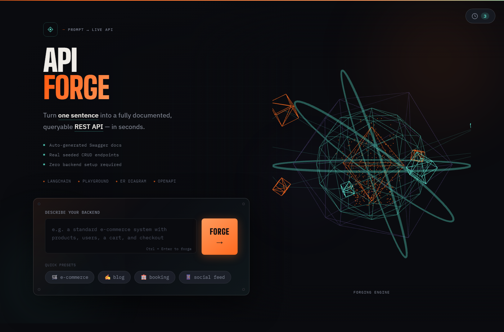
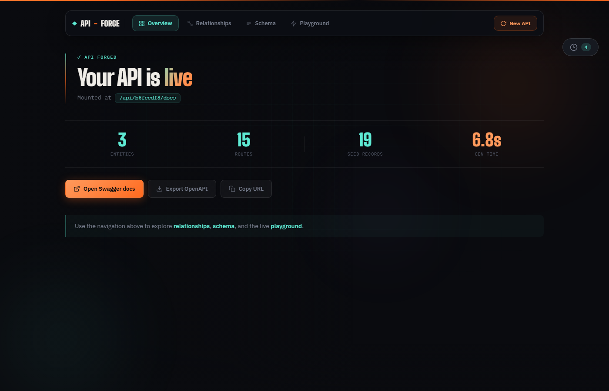
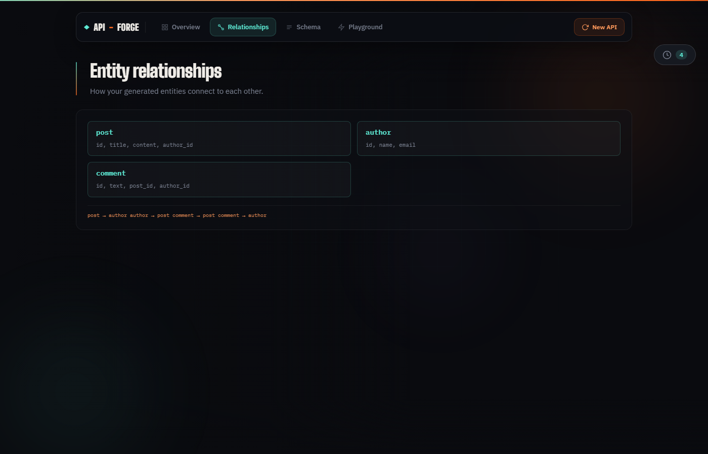
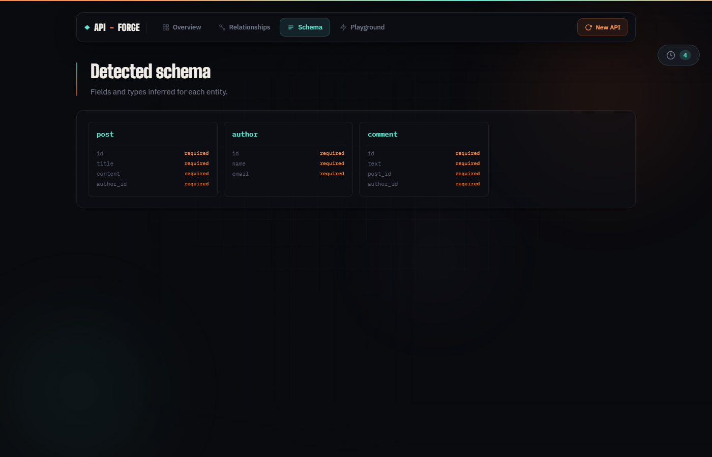
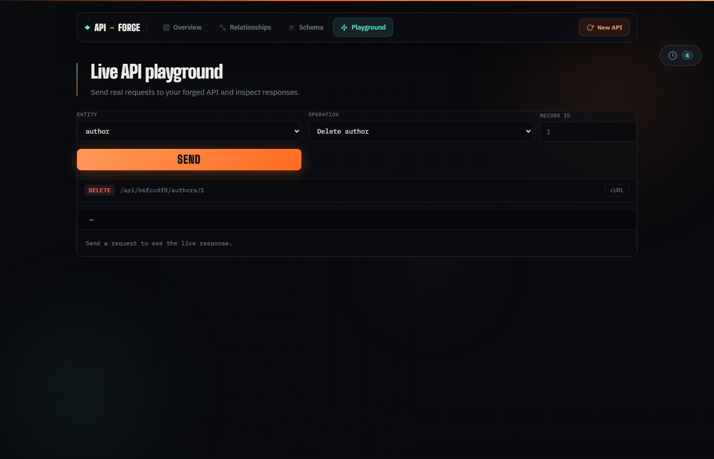

# API-Forge

Turn a single sentence into a fully documented, queryable REST API.

Describe a backend in plain English, e.g. *"a blog platform with posts, authors, and comments"*, and get back a live FastAPI server with realistic seed data, interactive Swagger docs, and a full dashboard to explore it.

## Status

A standalone personal project exploring structured-output LangChain pipelines and spec-driven API generation. Not tied to any hackathon submission.

## Screenshots

### Home: prompt & 3D forge engine



Split hero layout with prompt input, quick presets, and an animated 3D wireframe forge on the right.

### Overview: stats & actions



After forging, a navbar appears with an overview showing entity/route/record counts, generation time, and quick actions (Swagger, OpenAPI export, copy URL).

### Entity relationships



Visual map of generated entities and how they relate to each other.

### Detected schema



Field-level breakdown for every entity inferred from your prompt.

### Live API playground



Send real HTTP requests to your forged API and inspect live JSON responses, no Swagger tab required.

## Features

| Feature | Description |
|---|---|
| **Prompt → API** | LangChain + Groq generates schema and seed data from plain English |
| **Real REST endpoints** | Full CRUD per entity: list, get, create, update, delete |
| **Swagger docs** | Auto-generated OpenAPI/Swagger UI per API |
| **Live playground** | Test endpoints inline with cURL copy |
| **ER diagram** | Entity relationship visualization |
| **OpenAPI export** | Download the spec as JSON |
| **Session history** | Browse and reload previously forged APIs |
| **SQLite persistence** | APIs and records survive server restarts |
| **3D home screen** | Three.js forge animation on the landing page |

## Why this exists

Frontend teams routinely wait on backend teams to design a schema, seed data, and deploy endpoints just to start building UI. Tools like Mockoon, Beeceptor, and MockingCloud generate AI-powered mocks, but most need an existing OpenAPI spec or traffic first.

API-Forge starts from nothing but a sentence. The pipeline is split into three inspectable LangChain steps (schema, seed data, routes) rather than one opaque prompt-to-JSON call, and it produces real FastAPI-native Swagger docs, not a custom dashboard mimicking one.

## How it works

```
Prompt UI
   │  POST /generate?prompt=...
   ▼
FastAPI generation endpoint
   │  invokes
   ▼
LangChain pipeline
   Step 1: Schema chain   → EntitySpec[] (LLM, structured output)
   Step 2: Seed chain     → realistic records per entity (LLM)
   Step 3: Route builder  → RouteSpec[] (deterministic CRUD)
   │  writes
   ▼
SQLite store (data/forge.db) + in-memory cache
   │
   ▼
Per-api_id FastAPI sub-app mounted at /api/{api_id}
   → real routes, real Swagger docs, real CRUD
```

Each generated API is an independent mounted sub-application. Two APIs can run side by side without interfering with each other.

## Tech stack

| Layer | Choice |
|---|---|
| Backend | FastAPI |
| LLM orchestration | LangChain |
| LLM provider | Groq (`llama-3.3-70b-versatile`) |
| Schema validation | Pydantic v2 |
| Persistence | SQLite (stdlib, `data/forge.db`) |
| Frontend | HTML / CSS / JS + Three.js |
| Screenshots | Playwright (dev script) |

## Setup

```bash
python -m venv venv

# Windows PowerShell
venv\Scripts\Activate.ps1

# macOS / Linux
source venv/bin/activate

pip install -r requirements.txt
cp .env.example .env             # add your GROQ_API_KEY
```

## Run

```bash
uvicorn app.main:app --reload
```

Server runs at `http://127.0.0.1:8000`. Confirm it's up:

```bash
curl http://127.0.0.1:8000/health
```

Open `frontend/index.html` in a browser, or generate via CLI:

```bash
curl -X POST "http://127.0.0.1:8000/generate?prompt=A blog platform with posts, authors, and comments"
```

Visit `http://127.0.0.1:8000/api/{api_id}/docs` for live Swagger UI.

## Example prompts

| Prompt | Entities generated |
|---|---|
| A standard e-commerce backend with products, users, a shopping cart, and a stripe checkout simulation | product, user, cart, order, stripe_payment |
| A blog platform with posts, authors, and comments | post, author, comment |
| A hotel booking system with rooms, guests, and reservations | room, guest, reservation |
| A social feed with users, posts, and likes | user, post, like |

Any plain-English backend description works, these are just starting points.

## API endpoints

| Method | Path | Description |
|---|---|---|
| `GET` | `/health` | Health check |
| `POST` | `/generate?prompt=...` | Forge a new API |
| `GET` | `/apis` | List all forged APIs |
| `GET` | `/apis/{api_id}` | Get API metadata |
| `*` | `/api/{api_id}/...` | Generated CRUD routes |
| `GET` | `/api/{api_id}/docs` | Swagger UI |

## Regenerate README screenshots

Dev-only dependency, kept separate from the main install:

```bash
pip install -r requirements-dev.txt
python -m playwright install chromium
python scripts/capture_screenshots.py
```

Outputs to `docs/screenshots/`.

## Reliability

Groq's structured-output parsing occasionally fails on longer completions. Every chain call is wrapped in automatic retry logic (`app/utils/retry.py`), up to 3 attempts before surfacing a clean error.

## Project structure

```
app/
  main.py              FastAPI app, /generate, lifespan remount from SQLite
  models/schemas.py    Pydantic models for chains and serving
  chains/
    schema_chain.py    Prompt → entities (LLM)
    seed_chain.py      Entities → seed records (LLM)
    route_chain.py     Entities → CRUD routes (deterministic)
  serving/
    docs_mount.py      Per-api_id sub-app with live routes + Swagger
    store.py           SQLite-backed store with in-memory cache
    database.py        SQLite schema and connection
  utils/
    retry.py           Retry wrapper for LLM calls
    ids.py             api_id generation
frontend/
  index.html           Home screen + navbar dashboard
  app.js               Forge flow, navbar, playground, history
  style.css            UI styles
  forge3d.js           Three.js background animation
docs/
  screenshots/         README screenshots
scripts/
  capture_screenshots.py
data/
  forge.db             SQLite database (created at runtime, gitignored)
```

## Known limitations

- Routes are standard CRUD per entity (deterministic, not LLM-designed), a deliberate reliability choice.
- The forging progress animation is cosmetic UI; it does not reflect real-time backend pipeline stages.
- The 3D background is decorative only.
- SQLite is local single-file storage, not suited for multi-user production without further work.
